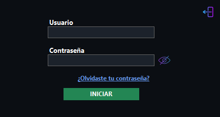
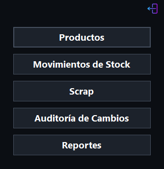
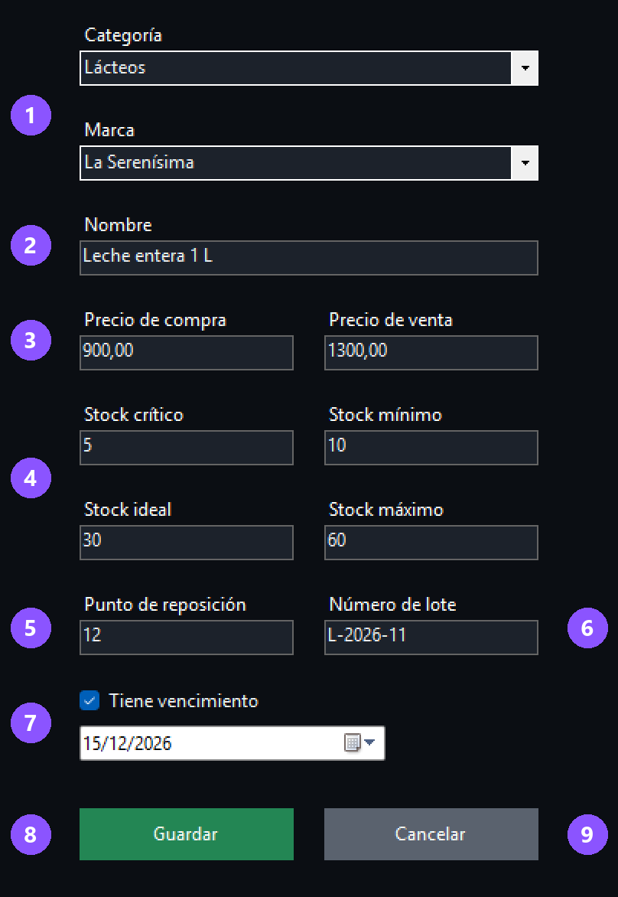
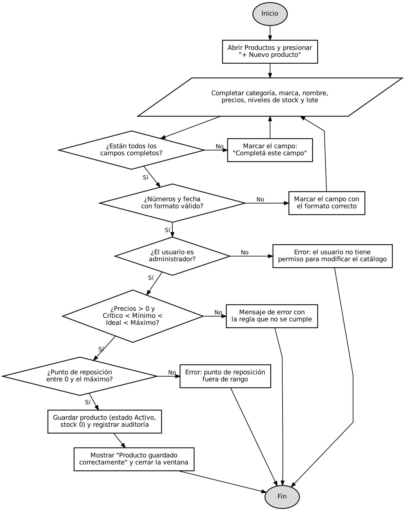

# Trabajo integrador: documentación de SistemaPP

Documentación de usuario y técnica de **SistemaPP**, el proyecto anual de Prácticas Profesionalizantes. Trabajo integrador individual de la materia Modelo y Sistemas, 7.º año.

- **Alumno:** Santino Carnevali
- **Profesor:** Gian Franco Denaro
- **Fecha de exposición:** 13 de noviembre de 2026

## Contenido del repositorio

| Archivo | Qué es |
|---|---|
| [`docs/Trabajo_Integrador_Santino_Carnevali.docx`](docs/Trabajo_Integrador_Santino_Carnevali.docx) | Trabajo escrito en formato APA: introducción, cinco apartados, conclusión y referencias |
| [`docs/Presentacion_SistemaPP.pptx`](docs/Presentacion_SistemaPP.pptx) | Presentación usada en la exposición |
| [`img/`](img) | Capturas del sistema y diagrama de flujo que se muestran en este README |

El código del sistema está en el repositorio del proyecto: <https://github.com/santycarnevaa/SistemaPP>

## Qué es SistemaPP

SistemaPP es una aplicación de escritorio para Windows que controla usuarios, productos y stock. Está hecha en C# con Windows Forms (.NET 8) y guarda la información en una base de datos SQL Server.

### Módulos

**Seguridad y usuarios**

- Inicio de sesión con roles de administrador y usuario
- Contraseña temporal que se cambia en el primer ingreso
- Preguntas de seguridad y recuperación de clave con un código por mail
- Políticas de contraseña configurables

**Productos y stock**

- Catálogo de productos con categorías y marcas
- Movimientos de stock (entradas y salidas) y kardex
- Baja de mercadería dañada (scrap)
- Auditoría de cada alta, baja o modificación, con el usuario que la hizo
- Reportes de productos para reponer y próximos a vencer

### Arquitectura

El código está organizado en capas:

| Capa | Responsabilidad |
|---|---|
| Vista | Pantallas de Windows Forms; muestra los datos y marca los campos con error |
| Lógica | Valida las reglas de negocio: permisos, precios y niveles de stock |
| Datos | Ejecuta los procedimientos almacenados de la base |
| Entidades | Clases que llevan la información de una capa a otra |

## Qué se documentó

El trabajo toma una tarea del sistema, **cargar un producto nuevo en el catálogo**, y la documenta de cuatro formas. Se eligió esa tarea porque es el primer paso para que funcione el control de stock y es donde el sistema aplica más reglas sobre los datos.

| Apartado | Tipo de documentación | Contenido |
|---|---|---|
| 1. Marco conceptual | — | Diferencia entre documentación de usuario y técnica |
| 2. Paso a paso | De usuario | Instructivo con tarea, objetivo, prerrequisitos, pasos, resultado y errores |
| 3. Diagrama de flujo | Técnica | Lógica de validación del alta, con simbología ISO 5807 |
| 4. Caso de uso | Técnica | CU-03 "Dar de alta un producto en el catálogo" |
| 5. Captura anotada | De usuario | Ventana Producto con referencias numéricas |

### Captura anotada

1. **Categoría y marca:** se eligen de las listas ya cargadas en el sistema.
2. **Nombre:** obligatorio; es el nombre con el que el producto aparece en las listas.
3. **Precio de compra y precio de venta:** los dos tienen que ser mayores a cero.
4. **Niveles de stock:** crítico, mínimo, ideal y máximo, de menor a mayor.
5. **Punto de reposición:** entre cero y el stock máximo.
6. **Número de lote:** identifica la partida del producto.
7. **Tiene vencimiento:** habilita la fecha, que no puede ser anterior al día actual.
8. **Guardar:** valida los datos y guarda el producto.
9. **Cancelar:** cierra la ventana sin guardar.

### Reglas que valida el sistema

- Solo el administrador puede modificar el catálogo.
- El precio de compra y el de venta tienen que ser mayores a cero.
- Los niveles de stock tienen que cumplir Crítico < Mínimo < Ideal < Máximo.
- El punto de reposición tiene que estar entre cero y el stock máximo.
- Si alguna regla falla, el producto no se guarda.

### Diagrama de flujo

El diagrama tiene cinco caminos alternativos. Dos son controles de la pantalla (campos completos y formato de los datos), que vuelven a la carga. Los otros tres son reglas de negocio, que terminan el intento sin guardar.

## Cómo ejecutar el sistema

Requisitos: Windows, Visual Studio 2022 con .NET 8 y SQL Server.

1. Clonar el repositorio del sistema: <https://github.com/santycarnevaa/SistemaPP>
2. Ejecutar `BaseDeDatos.sql` en SQL Server. El script crea la base `SistemaUsuariosDB` con sus tablas, procedimientos almacenados y datos iniciales.
3. Revisar la cadena de conexión en `WinFormsApp1/appsettings.json` y ajustar el nombre del servidor si no es `localhost`.
4. Para el envío de códigos por mail, copiar `mailsettings.example.json` como `mailsettings.json` y completar los datos del correo.
5. Abrir `SistemaPP.sln` en Visual Studio y ejecutar el proyecto.

## Referencias

- American Psychological Association. (2020). *Publication manual of the American Psychological Association* (7.ª ed.). https://doi.org/10.1037/0000165-000
- Cockburn, A. (2001). *Writing effective use cases*. Addison-Wesley.
- International Organization for Standardization. (1985). *Information processing — Documentation symbols and conventions for data, program and system flowcharts, program network charts and system resources charts* (ISO 5807:1985). https://www.iso.org/standard/11955.html
- Microsoft. (s.f.-a). *Documentación de Windows Forms para .NET*. Microsoft Learn. https://learn.microsoft.com/es-es/dotnet/desktop/winforms/
- Microsoft. (s.f.-b). *Documentación técnica de SQL Server*. Microsoft Learn. https://learn.microsoft.com/es-es/sql/sql-server/
- Pressman, R. S. (2010). *Ingeniería del software: Un enfoque práctico* (7.ª ed.). McGraw-Hill.
- Sommerville, I. (2011). *Ingeniería de software* (9.ª ed.). Pearson Educación.
